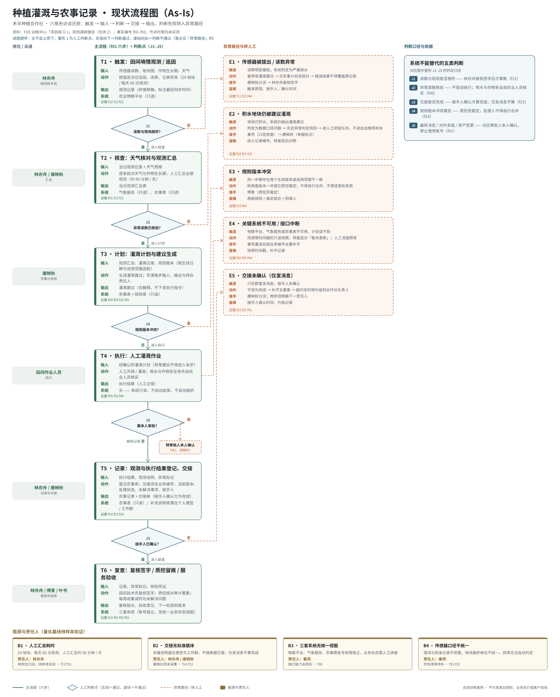
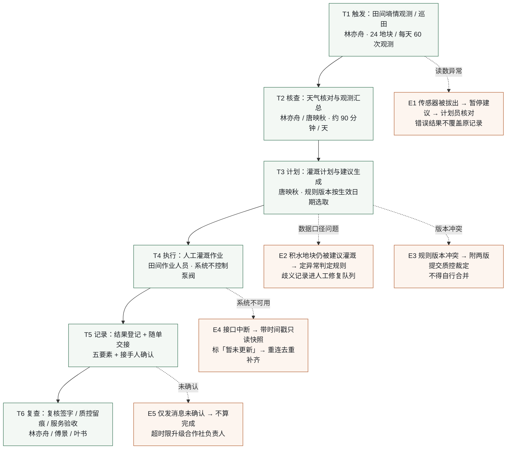

# 现状流程图

> **项目**：禾丰种植合作社 · 种植灌溉与农事记录
> **阶段**：02 现场调研 · 任务 2「还原现状流程」 ｜ 得分 72
> **要求**：画出触发、输入、交接、人工判断、输出及异常路径，在瓶颈处标明责任人
> **图的来源**：`src/data/process-model.json` → `src/diagram/build_flow_svg.py` 渲染 → `docs/assets/current-state-flow.svg`



> 若图片未显示（部分编辑器不渲染 SVG），可直接打开 `docs/assets/current-state-flow.svg` 查看；下方 Mermaid 版本可在 GitHub 直接渲染。

---

## 1. Mermaid 版本



---

## 2. 主流程节点表

| 步 | 节点 | 触发 / 输入 | 动作 | 输出 | 所用系统 | 责任人 |
| --- | --- | --- | --- | --- | --- | --- |
| T1 | 田间墒情观测 / 巡田 | 传感器读数、地块图、作物生长期、天气 | 按固定点位巡田、读表、记录异常（24 地块 / 每天 60 次） | 观测记录（终端草稿，标注最后同步时间） | 农业物联平台（只读） | 林亦舟 |
| T2 | 天气核对与观测汇总 | 当日观测记录 + 天气预报 | 逐条核对天气与作物生长期，人工汇总全部观测（约 90 分钟 / 天） | 当日观测汇总表 | 气象服务、农事表（只读） | 林亦舟 / 唐映秋 |
| T3 | 灌溉计划与建议生成 | 观测汇总、灌溉记录、规则版本 | 生成灌溉建议；写清每步输入、输出与待办责任人 | 灌溉建议（仅解释，不执行） | 农事表 + 规则库（只读） | 唐映秋 |
| T4 | 人工灌溉作业 | 经确认的灌溉计划 | 人工开阀 / 灌溉；用水与作物安全由农业人员核实 | 执行结果（人工记录） | 无（系统不启泵、不施药） | 田间作业人员 |
| T5 | 结果登记与随单交接 | 执行结果、现场说明、异常标记 | 登记农事表；交接待「五要素」补齐 | 农事记录 + 交接单（接手人确认方为完成） | 农事表（只读）+ 便签 / 群聊（现状） | 林亦舟 / 唐映秋 |
| T6 | 复核签字 / 质控留痕 / 服务验收 | 记录、异常标记、核验凭证 | 复核签字、审计要素核对、每周收集误判与未解决问题 | 复核结论、验收意见、下一轮规则版本 | 三套系统（无统一视图） | 林亦舟 / 傅景 / 叶书 |

---

## 3. 异常路径表

| 编号 | 异常 | 触发条件 | 动作 | 接手人 | 留痕要求 | 证据 |
| --- | --- | --- | --- | --- | --- | --- |
| E1 | 传感器被拔出 / 读数异常 | 读数明显偏低，系统判为严重缺水 | 暂停该建议 → 计划员核对 → 错误结果不得覆盖原记录 | 唐映秋分派，林亦舟复核签字 | 触发原因、接手人、确认时间 | `f11`、`f15`、`f44` |
| E2 | 积水地块仍被建议灌溉 | 地块已积水，系统仍输出建议 | 判定为口径问题 → 先定异常判定规则 → 进人工修复队列，不进自动推荐样本 | 秦芮（口径修复）、唐映秋（单据标注） | 歧义记录编号、修复前后对照 | `f10`、`f31`、`f33` |
| E3 | 规则版本冲突 | 同一步骤存在两个生效版本或适用范围不一致 | 附两套版本提交质控裁定；不得自行合并、不得选宽松条款 | 傅景（质控员） | 两版规则 + 裁定结论 + 回填人 | `f24`、`f44` |
| E4 | 关键系统不可用 / 接口中断 | 物联平台、气象服务或农事表不可用 | 改用带时间戳只读快照并显示「暂未更新」，人工流程照常 | 秦芮重连去重补齐 | 快照时间戳、补齐记录 | `f30`、`f35`、`f44` |
| E5 | 交接未确认（仅发消息） | 群里发消息，接手人未确认 | 不视为完成 → 补五要素 → 超约定时限升级到合作社负责人 | 唐映秋分派，跨岗明确下一责任人 | 接手人确认时间、升级记录 | `f23`、`f25`、`f51` |

---

## 4. 瓶颈与责任人

| 编号 | 瓶颈 | 现状表现 | 责任人 | 可量化基线 | 状态 |
| --- | --- | --- | --- | --- | --- |
| B1 | 人工汇总耗时 | 24 地块、每天 60 次观测，人工汇总约 90 分钟 / 天 | 林亦舟 | 90 分钟 / 天（单岗位口径） | 待样本验证 |
| B2 | 交接无标准载体 | 关键说明留在便签与工作群，不随单据交接；仅发消息不算完成 | 林亦舟 / 唐映秋 | 漏填比例、二次联系次数 | 未采集 |
| B3 | 三套系统无统一视图 | 物联平台、气象服务、农事表账号独立，业务状态靠人工拼接 | 秦芮 | 单据拼接口径耗时 | 未采集 |
| B4 | 传感器口径不统一 | 埋深与校准记录不完整、面积单位不统一，异常无法自动判定 | 秦芮 | 歧义记录占比 | 未采集 |

> 注意：管理层已明确「各节点的等待时间与处理时间**尚未分别量出**」（`f01`），因此上表的瓶颈排序是**待验证假设**，不是测量结论。

---

## 5. 只能由人完成的判断

| 编号 | 判断 | 为什么系统不能替代 | 证据 |
| --- | --- | --- | --- |
| J1 | 读数与现场是否相符 | 传感器代表性不足，必须现场比对后签字才算数 | `f15` |
| J2 | 异常读数核验 | 异常读数不得直接驱动执行，用水与作物安全由农业人员核实 | `f40` |
| J3 | 交接是否完成 | 接手人本人确认才算闭环，系统发送消息不等于完成 | `f23` |
| J4 | 规则版本冲突裁定 | 处理人不得自行合并或选宽松条款，须质控裁定 | `f24` |
| J5 | 最终决定 / 对外承诺 / 资产变更 | 必须对应审批人本人确认，禁止借用账号 | `f41` |

---

## 6. 理想流程 vs 现场做法

| 环节 | 理想（制度上应该怎样） | 现场实际 | 差异原因 | 对试点的影响 |
| --- | --- | --- | --- | --- |
| 观测 | 按固定点位、固定频次上传 | 24 地块每天 60 次，仍靠人工汇总 90 分钟 | 终端与网络受限，只能先存草稿 | 试点期必须保留人工汇总，不能假设全自动 |
| 异常识别 | 系统自动拦住异常建议 | 需人工绕田核对后才判断 | 传感器代表性不足、无异常判定规则 | 先做「异常提示 + 人工复核」，不做自动拦截 |
| 交接 | 单据随流转，责任自动转移 | 说明留在便签与群聊，事后补录 | 没有统一载体，五要素未强制 | 首期只做「五要素 + 接手人确认」的轻量载体 |
| 执行 | 系统下发并回写执行结果 | 人工开阀，结果人工记录 | 首期不控制泵阀（明确边界） | 执行仍为人工，系统只读 |
| 复核 | 全链路留痕、可重建六步链 | 复核靠签字，留痕不完整 | 审计要素未强制到单据 | 先把审计六要素挂到单据上 |
| 反馈 | 周度闭环、规则版本可追溯 | 反馈分散，版本变更无回填 | 无规则版本台账 | 需要一份最小规则台账 |

**结论**：现状的六步主链本身是通的，断点在**异常识别**与**交接留痕**两处；这两处正好是首期最小闭环要解决的问题。

---

## 7. 本图的待补项

1. 各节点的**标准时限**（等待时间 / 处理时间）尚未分别测量；
2. 异常分支的**退出与回退路径**未细化（例如质控否决后单据回退到哪一步、谁改、多久重提）；
3. 连续异常（同一地块反复误读）的**升级路径**未定义；
4. 人工判定细则（什么算「读数异常」）未成文；
5. 历史返工案例的原始单据凭证未取得，无法校核本图与真实流程的偏差。

---

## 8. 如何重新生成这张图

```powershell
# 在 planting 目录下
python src\diagram\build_flow_svg.py
```

- 数据：`src/data/process-model.json`（节点、异常、瓶颈、人工判断全在这里）
- 输出：`docs/assets/current-state-flow.svg`
- 依赖：仅标准库，无第三方包
