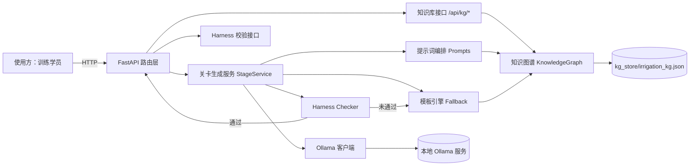

# 技术方案 · 种植灌溉与农事记录调研智能体

> **项目**：禾丰种植合作社 · 种植灌溉与农事记录（FDE 训练案例 `agriculture-irrigation`）
> **服务名**：`planting-irrigation-agent` ｜ **版本**：1.0.0
> **技术栈**：Python 3.11+ / FastAPI / NetworkX（知识图谱）/ Ollama（本地部署）/ 自研 Harness
> **文档性质**：工程说明，不含业务结论；业务结论见 `01-业务挖掘.md`

---

## 1. 一句话方案

把 36 条访谈事实（`f00–f55`）建成知识图谱，让本地大模型只能基于图谱证据写作，再用八条 Harness 规则在返回前拦截编造，最终产出可直接提交的关卡答卷。

**核心判断**：本项目的风险不在「模型能力不够」，而在「模型编造事实」。所以系统设计的重心是**证据约束 + 输出拦截**，而不是把模型调得更聪明。

---

## 2. 设计目标与硬约束

| 目标 | 落地方式 |
| --- | --- |
| 不编造事实 | 提示词只注入图谱证据；Harness 拦截非法编号、虚构实体、未访谈角色 |
| 可离线运行 | 本地 Ollama；不可用时降级为模板引擎，服务不中断 |
| 可核验 | 每条结论引用 `fxx`；Harness 校验编号是否真实存在 |
| 边界不越权 | 输出强制包含「只读 / 不自动控制泵阀 / 观测解释与灌溉建议」 |
| 可回归 | 固定权重评分，`scripts/verify.py` 一键跑全部断言 |

**明确不做**：不做自动控制泵阀、不做自动灌溉调度、不做多角色越权审批模拟、不引入数据库与消息中间件。

---

## 3. 总体架构



**生成链路的关键一环**：`Ollama 输出 → Harness 校验 → 未通过则丢弃并改用模板`。这个顺序保证了「不合规的内容永远不会到达调用方」。

---

## 4. 模块与职责

| 模块 | 路径 | 职责 |
| --- | --- | --- |
| 配置 | `app/core/config.py` | 读取 `config.yaml`，提供进程内单例 |
| 响应结构 | `app/core/response.py` | 统一 `{ok, data, error}` |
| 异常 | `app/core/exceptions.py` | 业务异常 + 全局兜底，不泄露堆栈 |
| 日志 | `app/core/logger.py` | 单一 handler，避免重复输出 |
| 知识图谱 | `app/kg/graph.py` | 图构建、持久化、检索、写入门闸 |
| 种子数据 | `app/kg/seed.py` | 36 条事实 + 6 角色 + I/O/R/G/流程节点 |
| 大模型 | `app/llm/ollama_client.py` | 探活、生成、失败降级 |
| 提示词 | `app/services/prompts.py` | 系统提示词 + 六任务骨架 + 证据注入 |
| 关卡生成 | `app/services/stage.py` | 生成、降级、Harness 前置校验 |
| 规则 | `app/harness/rules.py` | H1–H8 八条独立规则 |
| 编排 | `app/harness/checker.py` | 汇总、加权评分、阻断判定 |
| 路由 | `app/api/routes.py` | 13 个接口 |
| 入口 | `app/main.py` | lifespan 加载图谱、注册异常处理器 |

---

## 5. 知识图谱数据模型

### 5.1 节点类型

| 类型 | 前缀 | 数量 | 说明 |
| --- | --- | --- | --- |
| 角色 | `role:` | 6 | 岗位、关注点、权限边界、否决权 |
| 事实 | `fact:` | 36 | 证据编号、口述人、类型、正文、支撑强度 |
| 指标 | `metric:` | 6 | I1–I6，含分子/分母/时间窗/责任人/状态 |
| 业务机会 | `opp:` | 4 | O1–O4，含诉求/结果/损失/基线/缺口 |
| 规则 | `rule:` | 6 | R1–R6 硬边界 |
| 决策 | `decision:` | 5 | 立项、否决、验收、冲突裁定、本人确认 |
| 待补 | `gap:` | 9 | G1–G9 待核实事项 |
| 流程 | `flow:` | 6 | 六步主流程 |

### 5.2 边类型

| 关系 | 方向 | 含义 |
| --- | --- | --- |
| 口述 | role → fact | 该事实由谁讲 |
| 支撑 | fact → metric | 该指标由哪些事实支撑 |
| 依据 | fact → opp / rule / decision | 该结论的依据链 |
| 归属 | gap → role | 待补事项归属谁 |

### 5.3 为什么用图而不是表

三个查询场景决定了图结构：

1. **按角色取全部事实** → 角色节点出边遍历；
2. **按指标回溯证据** → 指标节点入边遍历；
3. **校验编号是否真实存在** → 节点是否在图中。

如果用关系表，这三个查询都要写额外 join；用图则是原生操作。规模只有 60 余节点，NetworkX 完全够用，不需要图数据库。

### 5.4 持久化

JSON（node-link 格式），路径由 `config.yaml` 的 `knowledge_graph.persist_path` 指定。

**不使用 pickle 的原因**：pickle 与 Python 版本绑定，换环境读不出来；JSON 可读、可 diff、可入库。

---

## 6. 提示词三层编排

| 层 | 内容 | 控制的边界 |
| --- | --- | --- |
| 系统提示词 | 身份、唯一事实来源、三层表述纪律、禁止项、强制项 | 模型「不能做什么」 |
| 任务骨架 | 六任务的写作结构与要点 | 模型「按什么顺序写」 |
| 证据块 | `<evidence>` 中 `fxx｜正文` 逐行注入 | 模型「依据什么写」 |

三层分离的好处：改关卡结构只动第二层，改事实只动图谱，不需要动系统提示词。

---

## 7. Harness 八条规则

| 规则 | 名称 | 权重 | 级别 | 检查内容 |
| --- | --- | --- | --- | --- |
| H1 | 响应结构 | — | block | 是否含 `ok / data / error`（校验返回体，单独判定） |
| H2 | 证据编号 | 15 | block | `fxx` 是否存在且不越界 |
| H3 | 角色错配 | 15 | block | 是否出现未访谈角色 |
| H4 | 虚构实体 | 10 | block | 是否出现 E01/R01/虚构地块作物 |
| H5 | 方案越界 | 15 | block | 是否把自动控制泵阀当方案 |
| H6 | 自创数值 | 5 | block | 是否出现未经抽样的工时与频次区间 |
| H7 | 边界声明 | 20 | block | 是否显式写明只读边界 |
| H8 | 数值标注 | 10 | warn | 量化数值是否带「待样本验证」 |

**H5 的否定语境处理**：`不自动控制泵阀` 本身包含违禁词，但它是必须保留的边界声明。规则实现上双向回看 10–12 字符判断否定词（不/禁止/不得/严禁/不做/无/非），只有非否定语境才判违规。这是本套规则里唯一需要语义判断的地方。

**H8 的前置断言**：`S2 天气核查`、`I1 观测` 这类编号里也含数字，若不排除会被误判成「2 天」。正则加上 `(?<![A-Za-z0-9])` 前置负向断言后，流程与指标编号不再干扰数值判断。

**评分规则**：H2–H8 合计 90 分，得分按 `通过权重 / 90 × 100` 归一化为百分制；H1 校验接口返回体，不参与文本评分。任一 block 级规则未通过即 `blocked=true`，生成服务会改走模板引擎。

---

## 8. 接口清单

| 方法 | 路径 | 说明 |
| --- | --- | --- |
| GET | `/health` | 探活，含图谱规模与模型状态 |
| GET | `/api/kg/stats` | 图谱统计 |
| GET | `/api/kg/roles` | 六个角色 |
| GET | `/api/kg/roles/{name}/facts` | 某角色口述事实 |
| GET | `/api/kg/facts/{evidence_id}` | 单条事实 |
| GET | `/api/kg/search?q=&limit=` | 全文检索 |
| GET | `/api/kg/evidence` | 证据索引全量导出 |
| GET | `/api/kg/opportunities` | 业务机会 O1–O4 |
| GET | `/api/kg/metrics` | 指标基线 I1–I6 |
| POST | `/api/kg/facts` | 人工确认后新增事实 |
| GET | `/api/tasks` | 六个关卡任务 |
| POST | `/api/generate` | 生成答卷（含 Harness 报告） |
| POST | `/api/harness/check` | 文本合规校验 |

**统一返回**：

```json
{"ok": true, "data": {...}, "error": {"code": "", "msg": ""}}
```

失败时 HTTP 状态码仍为 200，成败由 `ok` 表达，避免调用方同时处理两层错误语义。

---

## 9. 本地部署

### 9.1 前置

```powershell
# 1. 安装 Ollama（本地大模型运行环境）
#    下载地址：https://ollama.com/download

# 2. 查看本机已安装模型
ollama list

# 3. 如需更强的生成质量，可拉取更大模型，并同步改 config.yaml 的 ollama.model_name
ollama pull qwen2.5:7b
```

**模型名必须完全匹配**：`config.yaml` 里写 `qwen2.5:7b`，本机却只装了 `qwen2.5:0.5b` 时，
探活会判定为不可用并降级。本项目默认配置为 `qwen3:0.6b`，与本机环境一致，开箱可用。

> 实测记录：0.6B 模型能正常返回内容，但输出未通过 Harness（缺边界声明、数值未标注），
> 服务按设计丢弃该结果并改走模板引擎，`source` 字段标记为 `template(harness-fallback)`，
> 最终仍返回 100 分内容。这说明守门逻辑在真实模型下生效，而不是只在单测里通过。

### 9.2 启动服务

```powershell
cd "D:\祝欣荣老师的开源课程作业\planting"
python -m venv .venv
.\.venv\Scripts\Activate.ps1
pip install -r requirements.txt

# 启动
python run.py
# 访问 http://127.0.0.1:8000/docs 查看接口文档
```

### 9.3 验证

```powershell
python scripts\verify.py            # 离线验证（不需要启动服务）
python scripts\verify.py --online   # 在线验证（需服务已启动）
```

### 9.4 无 Ollama 时的行为

`config.yaml` 中 `ollama.enabled=true` 但服务不可达时，`StageService` 会自动走模板引擎，接口仍返回 200 与合规内容，`source` 字段标记为 `template`。这是刻意的降级设计，保证答辩或演示现场不会因为环境问题空转。

---

## 10. 目录结构

```
planting/
├── app/                              智能体服务
│   ├── main.py                       FastAPI 入口
│   ├── core/                         配置 / 响应 / 异常 / 日志
│   ├── kg/                           知识图谱与种子数据
│   ├── llm/                          Ollama 客户端
│   ├── harness/                      H1–H8 规则与评分
│   ├── api/                          路由
│   └── services/                     提示词与关卡生成
├── config.yaml                       全局配置（唯一配置源）
├── requirements.txt                  依赖清单
├── run.py                            启动脚本
├── scripts/
│   ├── verify.py                     阶段验证
│   └── build_docx.py                 技术方案转 Word
├── kg_store/                         图谱持久化目录
├── docs/                             业务文档与本文档
└── src/                              原始资料与流程图脚本
```

---

## 11. 关键设计决策

| 决策 | 选择 | 理由 |
| --- | --- | --- |
| 模型调用方式 | Ollama HTTP 原生接口 | 不引入额外 SDK，减少依赖与版本冲突 |
| 知识存储 | NetworkX + JSON | 规模小、免部署、可 diff |
| 编造防护位置 | 返回前拦截 | 事后人工检查成本高且不可靠 |
| 模型失败处理 | 降级模板 | 服务可用性优先于模型先进性 |
| 写操作 | 强制 `confirmed=true` | 单人可写会污染全库检索结果 |
| 评分 | 固定权重 | 便于回归比对，避免主观打分 |

---

## 12. 风险与待办

| 风险 | 影响 | 当前处理 | 后续动作 |
| --- | --- | --- | --- |
| H5 否定语境判断靠字符窗口 | 极少数表述可能误判 | 窗口 8 字符 + 否定词表 | 数据量足够后改用小型分类器 |
| 模板文本随业务结论变动需同步维护 | 文档与代码可能不一致 | 模板全部引证据编号 | 增加模板与 `docs/01` 的一致性检查 |
| 大模型输出长度不稳定 | 可能超长或截断 | `num_predict` 限制 | 增加长度分档与截断策略 |
| Ollama 模型版本不一致 | 生成风格漂移 | 配置固定模型名 | 启动时校验模型指纹 |
| 图谱人工写入无审批链 | 误写入难追溯 | 强制 confirmed | 增加写入人字段与审计日志 |

---

## 13. 验收口径

| 项 | 标准 |
| --- | --- |
| 接口可用 | 13 个接口全部返回统一结构 |
| 图谱完整 | 36 事实 / 6 角色 / 6 指标 / 4 机会 / 6 规则 |
| 生成合规 | 六任务 Harness 得分均为 100 |
| 拦截有效 | 六类负样本全部被拦 |
| 离线可用 | 无 Ollama 时仍返回合规内容 |

验证方式：`python scripts\verify.py`，全部断言通过即为达标。
